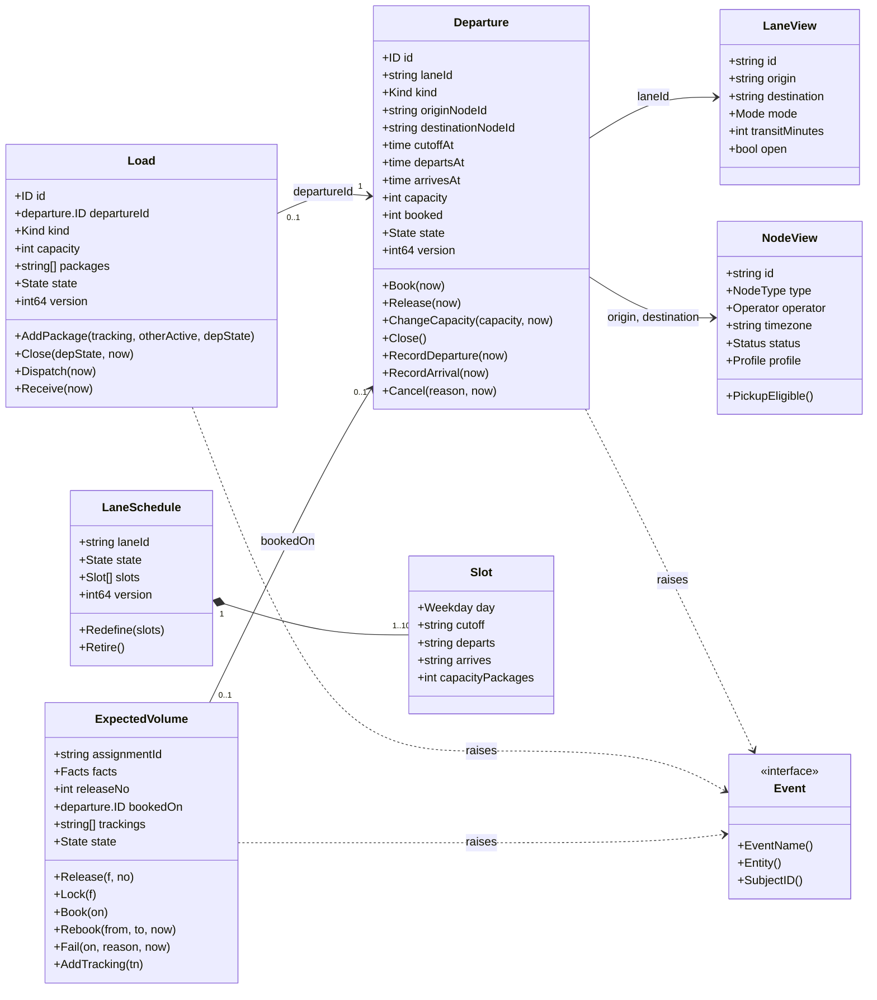
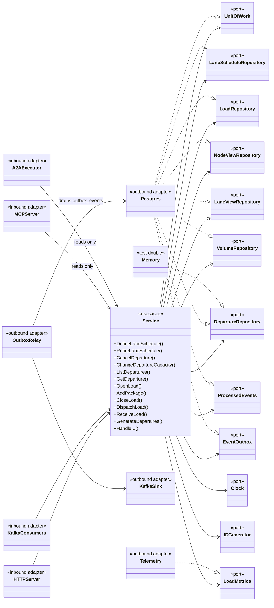

# Class diagrams

Two diagrams: the domain types, and the ports with the adapters that implement them. Unexported fields are shown where they carry an invariant.

## Domain model

Source: `internal/domain/departure/departure.go`, `internal/domain/schedule/schedule.go`, `internal/domain/load/load.go`, `internal/domain/volume/volume.go`,
`internal/domain/network/node.go`, `lane.go`, `internal/domain/shared/shared.go`.

Enumerations: `departure.Kind` = `PICKUP`, `LINEHAUL`, `AIR`; `departure.State` = `SCHEDULED`, `CLOSED`, `DEPARTED`, `ARRIVED`, `CANCELLED`; `load.State` = `OPEN`, `CLOSED`, `DEPARTED`, `ARRIVED`;
`schedule.State` = `ACTIVE`, `RETIRED`; `volume.State` = `UNKNOWN`, `RELEASED`, `BOOKED`, `FAILED`, `CANCELLED`; `network.Mode` = `GROUND`, `AIR`; `network.Operator` = `NETWORK`, `VENDOR`.
Pure planning functions: `schedule.PlanLane`, `schedule.PlanPickups`. Domain events: `DepartureScheduled`, `DepartureCapacityChanged`, `DepartureCancelled`, `DepartureDeparted`, `DepartureArrived`, `LoadClosed`, `LoadDeparted`, `LoadArrived`,
`BookingMoved`, `BookingFailed`.

## Ports and adapters

Source: `internal/application/ports/ports.go` (the port interfaces), `internal/application/usecases/service.go` (`Deps`), `cmd/api/main.go` (`buildApp`), `cmd/mcp/main.go`, `cmd/a2a/main.go`,
`internal/adapters/**`. `Clock` and `IDGenerator` are implemented by `outbound/clock` and `outbound/ids`; `Memory` stands for `outbound/memory`, which implements all repository ports for tests only and is never
imported by `cmd/**`. `cmd/mcp` and `cmd/a2a` give the `Service` only the departure repository.
