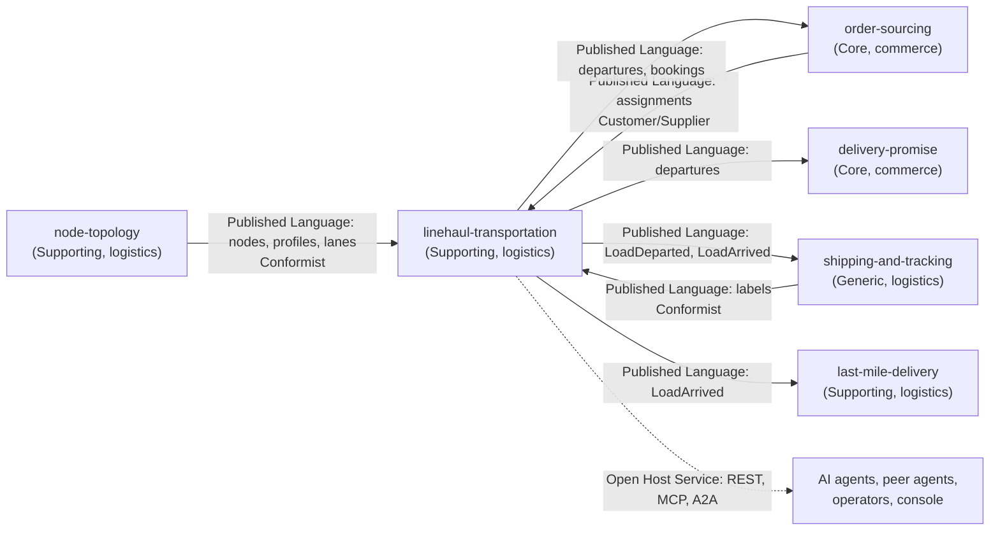

# Context map

This context's slice of the network map, following [Context Mapping](https://github.com/ddd-crew/context-mapping). Relationship patterns come from
[ADR 0001](/docs/adr/0001-linehaul-transportation-bounded-context) and [ADR 0003](/docs/adr/0003-consumed-contracts-and-local-read-models). The **Status** column says, per edge, what the code
on `develop` of each side does (checked on 2026-10-31); the network-wide map is on the
[retail-network pages of warehouse-docs](https://iqvo.github.io/warehouse-docs/network/strategic-design/context-map).

Source: `docs/adr/0001-linehaul-transportation-bounded-context.md`, `docs/adr/0003-consumed-contracts-and-local-read-models.md` (relationship column),
`internal/adapters/inbound/kafka/handlers.go`, `apis/asyncapi.yaml`, and the consumers in the sibling repositories: `delivery-promise/internal/adapters/inbound/kafka/dispatch.go`,
`order-sourcing/internal/adapters/inbound/kafka/handlers.go`, `shipping-and-tracking/internal/adapters/inbound/kafka/handlers.go`,
`last-mile-delivery/internal/adapters/inbound/kafka/consumers.go`. Solid arrows are Kafka topics with code on both sides; the dotted arrow is the request/response surface.

## Edges

| Edge | Relationship | Status |
| --- | --- | --- |
| node-topology -> linehaul-transportation | Published Language (`retailnetwork.node-topology.events`); this context is a **Conformist** and keeps local node and lane views | Consumer **built** (always on; group `NODE_TOPOLOGY_CONSUMER_GROUP`) |
| order-sourcing -> linehaul-transportation | Published Language (`FulfillmentReleasedToNode`, `FulfillmentReassigned`, `FulfillmentLocked`, `FulfillmentCancelled`); **Customer/Supplier**: order-sourcing names the pickup departure, this context books it | Consumer **built** (group `ORDER_SOURCING_CONSUMER_GROUP`) |
| shipping-and-tracking -> linehaul-transportation | Published Language (`LabelIssued`, `LabelVoided`); **Conformist** | Consumer **built** (group `SHIPPING_AND_TRACKING_CONSUMER_GROUP`) |
| linehaul-transportation -> order-sourcing | Published Language on `retailnetwork.linehaul-transportation.events`; order-sourcing reads departures, capacity and cancellations and receives `BookingMoved` | Producer **built**; order-sourcing consumer **built** (`LINEHAUL_TRANSPORTATION_CONSUMER_GROUP`); `BookingFailed` is received and changes no state there |
| linehaul-transportation -> delivery-promise | Published Language (`DepartureScheduled`, `DepartureCapacityChanged`, `DepartureCancelled`); delivery-promise builds witness paths from them | Producer **built**; consumer **built** |
| linehaul-transportation -> shipping-and-tracking | Published Language (`LoadDeparted`, `LoadArrived`) | Producer **built**; consumer **built** |
| linehaul-transportation -> last-mile-delivery | Published Language (`LoadArrived`) | Producer **built**; consumer **built** |
| linehaul-transportation -> analytics readers | Published Language on `retailnetwork.linehaul-transportation.analytics` | Producer **built**; no consumer found in the sibling repositories |
| linehaul-transportation -> agents and operators | **Open Host Service**: REST (`GET /departures` for any context), MCP and A2A reads, the `linehaul_mfe` console remote | Built; no sibling context is a REST client |

## Deliberate non-edges

- No outbound REST, MCP or A2A call to any context: the service "calls no sibling at runtime" (`CLAUDE.md`, ADR 0003).
- No edge to `vendor-connectivity`, `node-performance`, `seller-inbound`, `offer-availability` or `customer-ordering`.
- No edge to the warehouse-systems fleet: the fleet reaches the network only through the Vendor API of `vendor-connectivity`.
- No cross-context database access: this context owns its database and holds only event-fed copies of node, lane and assignment facts.
