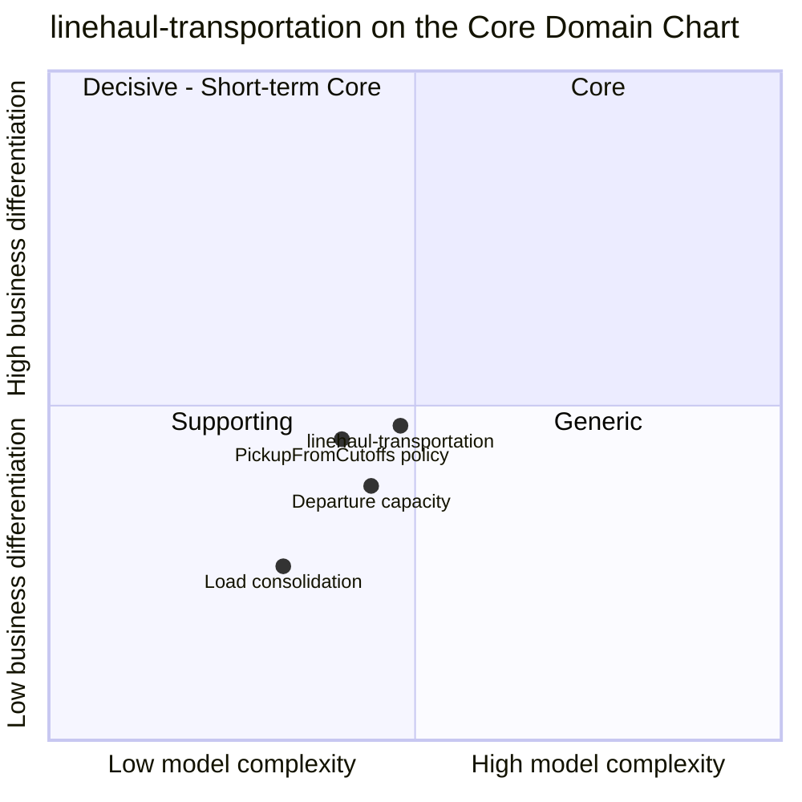

# Core domain chart

Following the ddd-crew [Core Domain Charts](https://github.com/ddd-crew/core-domain-charts): business differentiation (y) against model complexity (x). The network-wide chart is on the
[retail-network pages of warehouse-docs](https://iqvo.github.io/warehouse-docs/network/strategic-design/core-domain-chart).

Source: the context point (`complexity` 0.48, `differentiation` 0.47) is the one in the retail-network model chart; the three slices are this page's reading of
`internal/application/usecases/generate.go` (`PickupFromCutoffs`), `internal/domain/departure` (capacity) and `internal/domain/load`. All of them stay in the Supporting quadrant.

## Classification: Supporting

The context point sits in the **Supporting** quadrant, just below and left of the centre. Business model: cost reducer and speed enabler.

**Differentiation is moderate.** The network's differentiating promise is made in `delivery-promise` and kept by the choices of `order-sourcing` (both Core). They cannot work without real
departures: a fast tier is not promised from nominal lane times. So this context is close to the Core line. It stays below it because it does not decide what the customer is promised or
which node ships; it supplies the trips and keeps their capacity honest. The highest slice is `PickupFromCutoffs`, because it is where a vendor's declared cutoff becomes a bookable pickup.

**Model complexity is moderate.** Four small aggregates (`Departure` with five states, `LaneSchedule` with two, `Load` with four, `ExpectedVolume` with five), a handful of invariants and
three policies (`HorizonRoll`, `PickupFromCutoffs`, `BookOnLock`). The hard parts are temporal, not structural: time zones and operating days when generating pickups, a 14-day rolling horizon,
capacity that changes days ahead, rebooking when a departure is cancelled, and the ordering of node-topology events (registered, profile declared, activated, lanes opened).
Loads are plain consolidation and plotted lowest.

## Evolution

| Part | Evolution stage | Why |
| --- | --- | --- |
| Pickup generation from vendor cutoffs | Custom-built | Specific to a network that lets vendors declare their own cutoffs and must schedule its own trucks against them |
| Departure capacity ledger and rebooking | Custom-built | A counter with rebooking rules whose events feed the promise and sourcing read models |
| Lane schedules and loads | Custom-built, a candidate for a product | Weekly templates and load building are well-known transport-management functions; a product could replace them if it published the same events |
| Plumbing (outbox, inbox, CloudEvents) | Commodity | The same building blocks as every context |

**Movement to watch.** If the network began to compete on the middle mile itself (dynamic capacity bought per day, load-level re-routing to save a promise), the capacity slice would move
right and up, towards Core. Today a planner can change a departure's capacity (`PUT /departures/{departureId}/capacity`) and a cancelled departure rebooks its assignments onto the
next pickup, but nothing optimises routes or buys capacity.
