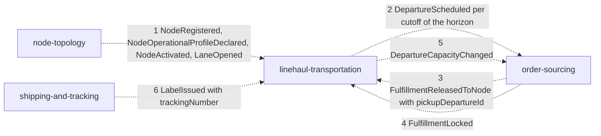
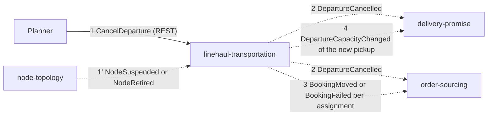
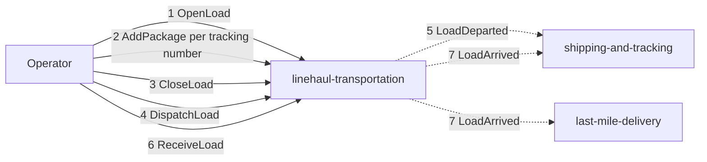
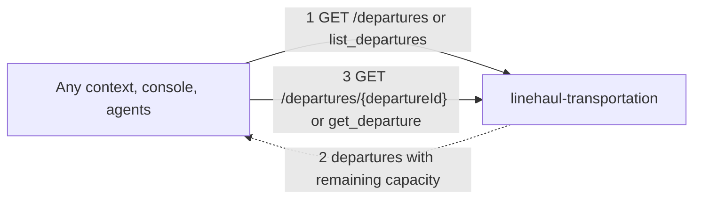

# Domain message flow

Following [Domain Message Flow Modelling](https://github.com/ddd-crew/domain-message-flow-modelling): commands are solid, events are dashed, queries are dotted; numbers give the order. Only messages
that exist in the code are drawn.

## Scenario 1: a vendor declares cutoffs and a package is booked on the pickup

Source: `internal/application/usecases/consumers.go`, `generate.go`, `booking.go`; consumers in `order-sourcing/internal/adapters/inbound/kafka/handlers.go`.

1. node-topology publishes the node, its profile with cutoffs and an outbound lane. This context stores the views and plans one PICKUP departure per cutoff for the next 14 days.
2. Each new departure is announced as `DepartureScheduled`. order-sourcing and delivery-promise project it.
3. order-sourcing releases an assignment to the node, naming the pickup departure. This context records an `ExpectedVolume` (RELEASED).
4. At the lock, the context books one package on the pickup departure (`BookOnLock`).
5. The new booked count is published as `DepartureCapacityChanged`.
6. When the label is issued, the tracking number is attached to the expected volume.

## Scenario 2: a departure is cancelled and bookings move

Source: `internal/application/usecases/departures.go`, `booking.go`, `consumers.go` (`leaveService`).

1. A planner cancels a SCHEDULED departure, or node-topology suspends or retires a vendor node (all its future pickups are cancelled).
2. `DepartureCancelled` lets delivery-promise revise promises that rested on it.
3. Each assignment booked on it is rebooked on the next pickup from the same origin (`BookingMoved`) or fails (`BookingFailed`).
4. The receiving pickup's capacity change is published.

## Scenario 3: a load travels

Source: `internal/application/usecases/loads.go`; consumers in `shipping-and-tracking/internal/adapters/inbound/kafka/handlers.go` and `last-mile-delivery/internal/adapters/inbound/kafka/consumers.go`.

1 to 3 are silent for other contexts (`LoadClosed` goes to the analytics topic). 4 records the departure of the trip and publishes `LoadDeparted` with the tracking numbers. 6 records the arrival at the destination node and
publishes `LoadArrived`, which last-mile-delivery uses to induct packages when the destination is a delivery station.

## Scenario 4: reading departures

Source: `internal/adapters/inbound/http`, `internal/adapters/inbound/mcp`, `internal/adapters/inbound/a2a`. No sibling context is known to call these routes today; they are the Open Host Service for any context and for agents.
