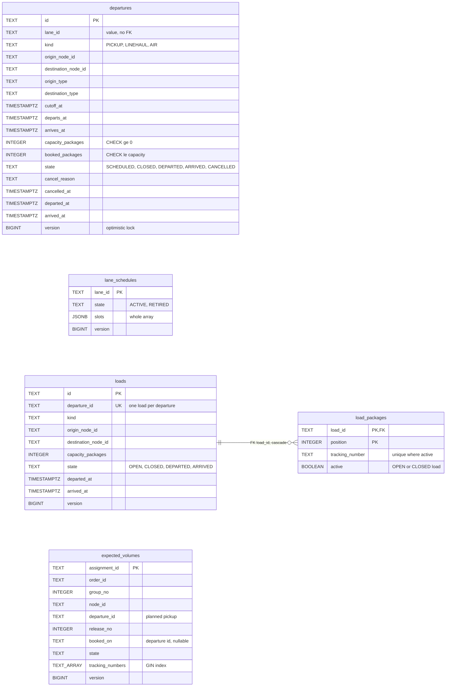
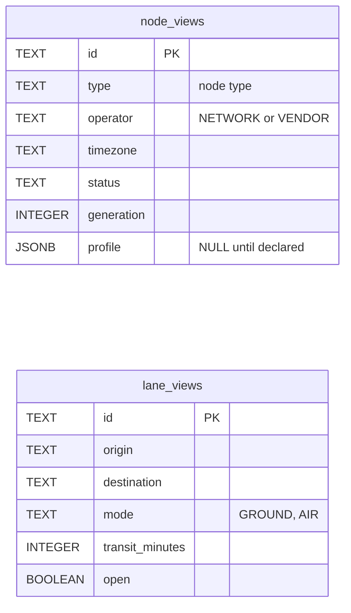
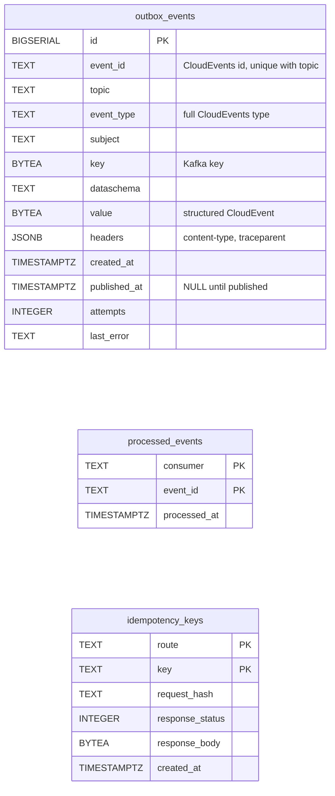

# Entity-relationship diagram

The schema created by `internal/adapters/outbound/postgres/migrations/0001_linehaul_schema.up.sql` (ten tables; golang-migrate adds its own `schema_migrations` bookkeeping table). The context owns
its database and no table is shared with another context. A relationship line is drawn only where a foreign key exists; everything else is a value reference.

## Aggregates

Source: `0001_linehaul_schema.up.sql` (tables `departures`, `lane_schedules`, `loads`, `load_packages`, `expected_volumes`).

`departures` has `CHECK (cutoff_at <= departs_at AND departs_at < arrives_at)` and indexes on `(cutoff_at, id)`, `(origin_node_id, cutoff_at)` and `(destination_node_id, cutoff_at)` for `GET /departures`.
`load_packages` has the partial unique index `load_packages_active_tracking_key (tracking_number) WHERE active`, which enforces "a package is on at most one OPEN or CLOSED load" (`ErrPackageAlreadyLoaded`).
`loads.departure_id` is unique (`loads_departure_id_key`). `lane_id`, `departure_id` and node ids are values, not foreign keys, because the aggregates are separate consistency boundaries
and the nodes and lanes belong to other contexts.

## Local read models

Source: `0001_linehaul_schema.up.sql` (`node_views`, `lane_views`), ADR 0003. `lane_views` is indexed on `(origin, id)` and `(destination, id)`. Both tables are replaced as a whole from node-topology events.

## Infrastructure

Source: `0001_linehaul_schema.up.sql` (`outbox_events`, `processed_events`, `idempotency_keys`).

- `outbox_events` is written in the same transaction as the aggregate and drained by the relay; the partial index `idx_outbox_events_unpublished (id) WHERE published_at IS NULL` keeps the scan small;
  `(event_id, topic)` is unique so a retry republishes the same id.
- `processed_events` is the inbox: `(consumer, event_id)` is claimed with `INSERT ... ON CONFLICT DO NOTHING` in the same transaction as the effect, so a rollback un-claims it.
- `idempotency_keys` stores the first response of each `(route, key)`; rows older than 24 hours are deleted by every keyed write.

## Table to aggregate

| Table | Aggregate or role | Notes |
| --- | --- | --- |
| `departures` | **Departure** | One row per departure; `version` guards contended bookings |
| `lane_schedules` | **LaneSchedule** | One row per lane; slots in one JSONB array |
| `loads`, `load_packages` | **Load** | Capacity, nodes and kind are snapshots of the departure |
| `expected_volumes` | **ExpectedVolume** | One row per fulfillment assignment |
| `node_views`, `lane_views` | read models | Fed by node-topology events |
| `outbox_events`, `processed_events`, `idempotency_keys` | infrastructure | Outbox, inbox, REST replay store |
