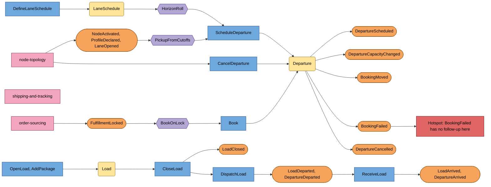

# EventStorming

A design-level storm following the [EventStorming glossary](https://github.com/ddd-crew/eventstorming-glossary-cheat-sheet): orange events, blue commands, lilac policies, yellow aggregates, pink external systems,
red hotspots. Chronology runs left to right; the diagram is read as "command, aggregate, event, policy, next command".

Source: `internal/domain/departure/events.go`, `internal/domain/load/events.go`, `internal/domain/volume/events.go`, `internal/application/usecases/*.go` (policy names in the comments of `generate.go`, `consumers.go`).

## Timeline in words

1. **Network is shaped** (external): node-topology registers nodes, declares profiles with cutoffs, activates vendor fulfillment centres and opens lanes.
2. **Policy `PickupFromCutoffs`**: every cutoff of a pickup-eligible node gets a PICKUP departure for the horizon, and stale unbooked ones are cancelled when the profile changes.
3. **Planner defines a lane schedule**; **policy `HorizonRoll`** turns its slots into LINEHAUL or AIR departures every `GENERATE_INTERVAL`. `DepartureScheduled` is the first event other contexts see.
4. **Order-sourcing locks an assignment**; **policy `BookOnLock`** books one package, or moves the booking, or fails it.
5. **A departure may be cancelled** by the planner or by a node leaving service: its bookings are rebooked.
6. **Operators build the load**: open, add packages, close (the departure closes with it), dispatch (departure leaves), receive (departure arrives).

## Hotspots

| Hotspot | State |
| --- | --- |
| `BookingFailed` is received by order-sourcing but changes no state there; what happens to an assignment that no pickup can hold is not decided in either context | open |
| `FulfillmentCancelled` only updates the expected volume (ADR 0002 A16): it never releases the package booked on a departure | accepted assumption |
| A `LabelVoided` removes the tracking number but keeps the booking (A18) | accepted assumption |
| Outbox backlog, consumer lag and dead letters are not metered | open, see [Observability](/docs/operations/observability) |
| A row past `OUTBOX_MAX_ATTEMPTS` lets later events of the same aggregate overtake it | accepted, see [Runbook](/docs/operations/runbook) |
