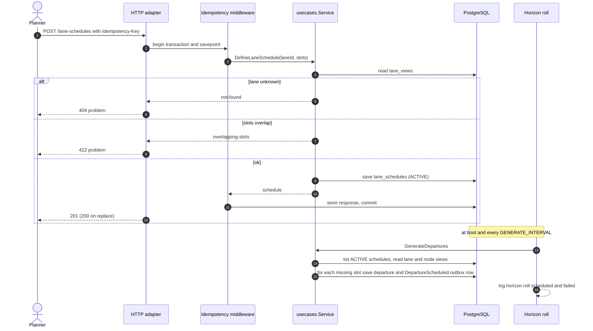
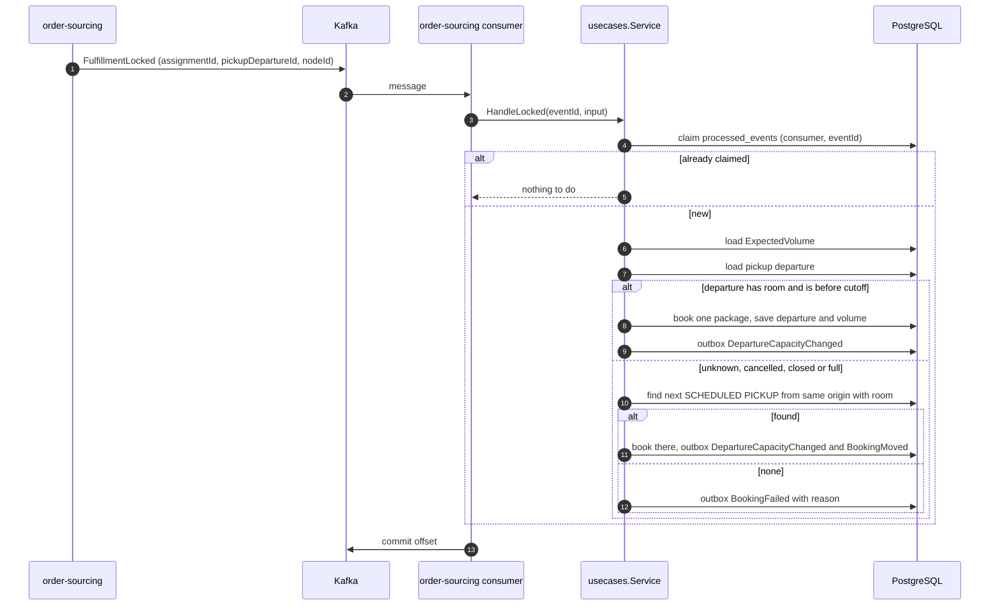
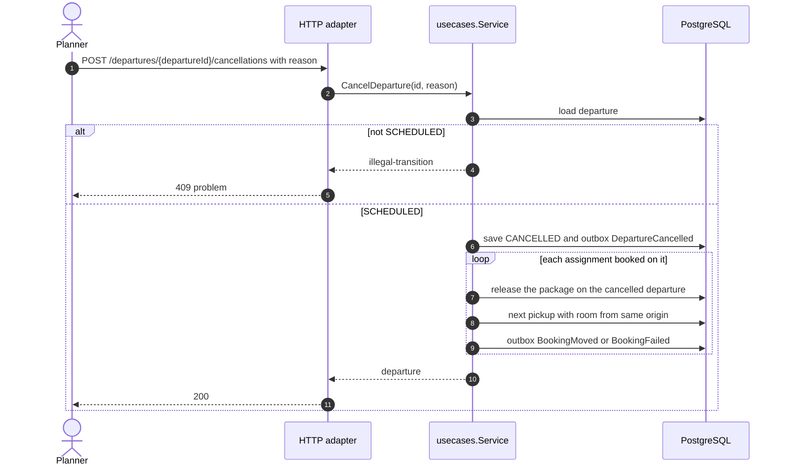
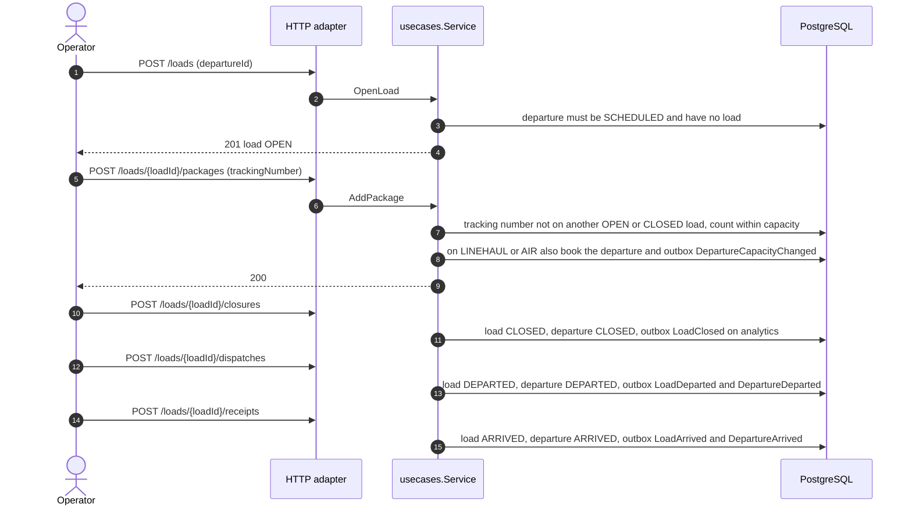
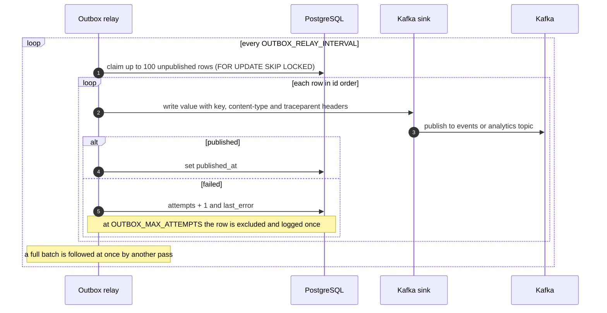
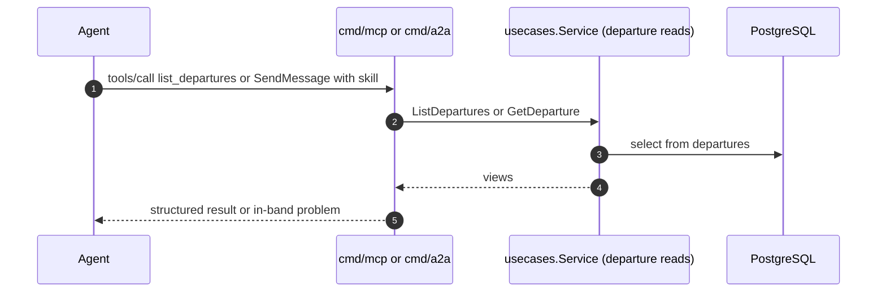

# Sequence diagrams

Each diagram follows the code path of one use case ([Use cases](/docs/ddd/use-cases)). Every state change commits aggregate rows and outbox rows in one Postgres transaction, so the diagrams
show `PG` once per transaction.

## 1. Define a lane schedule and generate departures

Source: `internal/adapters/inbound/http/server.go`, `idempotency.go`, `internal/application/usecases/schedules.go`, `generate.go`, `cmd/api/main.go` (`horizonRoll`).

## 2. Book on lock, rebook or fail

Source: `internal/application/usecases/consumers.go` (`HandleLocked`), `booking.go` (`place`, `rebookOrFail`), `internal/adapters/inbound/kafka/kafka.go`.
A handler error is retried on the same message and dead-lettered after 5 attempts ([Runbook](/docs/operations/runbook)).

## 3. Cancel a departure and rebook its assignments

Source: `internal/application/usecases/departures.go` (`CancelDeparture`), `booking.go` (`cancel`, `moveBookingsOff`). The same path runs for `NodeSuspended`, `NodeRetired` and a revised profile.

## 4. Load lifecycle

Source: `internal/application/usecases/loads.go`, `internal/domain/load/load.go`. Dispatching an OPEN load answers `409 illegal-transition`; repeating a command that already holds returns the load unchanged.

## 5. Outbox relay

Source: `internal/adapters/outbound/outbox/relay.go`, `internal/adapters/outbound/postgres/outbox_repository.go`, `internal/adapters/outbound/kafka`.

## 6. Reading through MCP or A2A

Source: `cmd/mcp/main.go`, `cmd/a2a/main.go`, `internal/adapters/inbound/mcp`, `internal/adapters/inbound/a2a`. Neither binary can write: the `Service` is built with the departure repository only.
