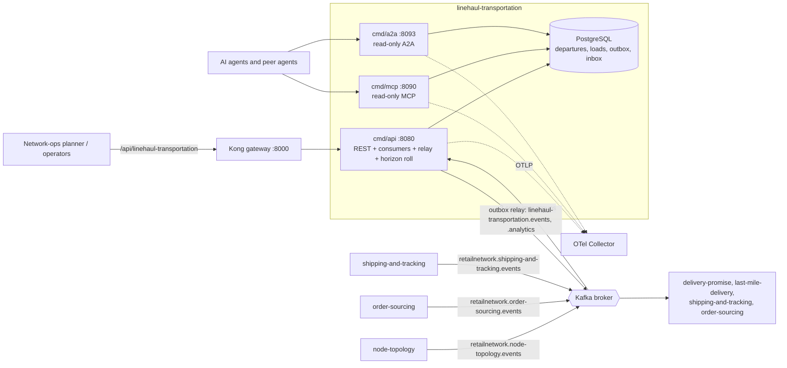

# Architecture

Linehaul Transportation is a hexagonal (ports and adapters) Go service. Dependencies point inward only, and the rule is enforced by tests in
`internal/architecture/` rather than by convention ([Testing](/docs/development/testing)).

## Layout

```text
cmd/api/                      composition root: REST, the three Kafka consumers, the outbox relay, the horizon roll
cmd/mcp/                      composition root: read-only MCP server (Streamable HTTP)
cmd/a2a/                      composition root: read-only A2A agent (JSON-RPC)
internal/
  domain/                     pure Go, no I/O: shared, departure, schedule, load, network, volume
  application/                usecases (Service), ports, repository interfaces, views, outbox
  adapters/
    inbound/http/             chi router, handlers, DTOs, RFC 9457 problems, Idempotency-Key middleware, /healthz, /readyz
    inbound/kafka/            the node-topology, order-sourcing and shipping-and-tracking consumers, dead letters, tracing
    inbound/mcp/              MCP tools list_departures and get_departure
    inbound/a2a/              A2A executor and skills list_departures and get_departure
    inbound/requestlog/       one structured log line per request
    outbound/postgres/        pgx repositories, unit of work, embedded golang-migrate SQL, outbox and inbox tables
    outbound/kafka/           relay sink (integration and analytics writers), broker health check
    outbound/outbox/          the relay loop
    outbound/telemetry/       OpenTelemetry setup, trace-correlated slog handler, the loads-dispatched counter
    outbound/clock, ids/      wall clock and id source
    outbound/memory/          in-memory doubles for tests (never imported by cmd/**)
    outbound/repocontract/    the shared repository contract suite (never imported by cmd/**)
    kafka/cloudevents, wire/  the CloudEvents 1.0 envelope and the event-to-message encoder
  architecture/               the fitness tests
features/                     godog acceptance tests
web/                          the linehaul_mfe console remote (read-only React UI)
charts/linehaul-transportation/  Helm chart
apis/                         openapi.yaml, asyncapi.yaml
```

- **Domain** (`internal/domain`): the aggregates `departure.Departure`, `schedule.LaneSchedule`, `load.Load` and `volume.ExpectedVolume`, the
  local read-model types in `network` (`NodeView`, `LaneView`), the planning functions `schedule.PlanLane` and `schedule.PlanPickups`, and the domain events. It
  imports nothing from the application or the adapters.
- **Application** (`internal/application`): the `usecases.Service` with one method per use case ([Use cases](/docs/ddd/use-cases)), the repository and port
  interfaces it needs (`UoW`, repositories, `Inbox`, `Outbox`, `Clock`, `IDs`, `LoadMetrics`), the read `views`, and the outbox message type.
- **Inbound adapters** call the `Service`; **outbound adapters** implement its ports. Adapters never import each other: `cmd/*` wires them together.
- The memory and repository-contract packages are test doubles: `TestRuntimeBinaryHasNoInMemoryAdapters` fails if a binary imports them.

## Binaries

| Binary | Role | Port | Writes? | Talks to |
| --- | --- | --- | --- | --- |
| `cmd/api` | REST API, Kafka consumers, outbox relay, horizon roll, `/healthz` and `/readyz` | `:8080` (`HTTP_ADDR`) | Yes, the only writer | Postgres, Kafka |
| `cmd/mcp` | MCP server: `list_departures`, `get_departure`; `/mcp` and `/`, `/healthz` | `:8090` (`MCP_ADDR`) | No | Postgres |
| `cmd/a2a` | A2A agent: JSON-RPC on `/` and `/a2a`, Agent Card on `/.well-known/agent-card.json`, `/healthz` | `:8093` (`A2A_ADDR`) | No | Postgres |

`cmd/mcp` and `cmd/a2a` build `usecases.Deps` with the departure repository only (no unit of work, no outbox), so no write path is reachable
(`TestMCPServerIsReadOnly`, `TestA2AAdapterIsReadOnly`). They run the idempotent embedded migrations at start and read the database `cmd/api` owns.
REST, MCP and A2A have no authentication; access control is the cluster network boundary. The three binaries ship in one image (`/app/api`,
`/app/mcp`, `/app/a2a`; entrypoint `./api`) and are separate Deployments in the chart ([Runtime](/docs/overview/runtime)).

## Container diagram



Source: `cmd/api/main.go` (`buildApp`), `cmd/mcp/main.go`, `cmd/a2a/main.go`, `internal/adapters/inbound/kafka/consumer.go`, `internal/adapters/kafka/wire/wire.go`.

The downstream box lists the contexts that the model and the sibling services name as consumers of the published events; this service does not know them
and calls none of them ([Integration](/docs/ecosystem/integration)).

## Data stores

| Store | Used by | Content |
| --- | --- | --- |
| PostgreSQL (one database, embedded migrations) | all three binaries | Aggregates (`departures`, `lane_schedules`, `loads`, `load_packages`, `expected_volumes`), local read models (`node_views`, `lane_views`), `outbox_events`, `processed_events` (inbox), `idempotency_keys`. See [Entity-relationship](/docs/ddd/entity-relationship). |
| Kafka | `cmd/api` only | Consumes three topics, publishes two, dead-letters to `<topic>.dlq`. No state of its own. |

There is no cache and no other database. Every write is one Postgres transaction (aggregate rows plus encoded outbox rows plus the inbox claim),
which is why a write is accepted while Kafka is down.

## How a write travels

1. A REST command passes the Idempotency-Key middleware, which opens the transaction and a savepoint.
2. The use case loads the aggregate, calls its domain method (which checks the invariants and returns events), saves it with a version check.
3. The events are encoded to CloudEvents and inserted into `outbox_events` in the same transaction; commit.
4. The relay claims unpublished rows (`FOR UPDATE SKIP LOCKED`), writes them to `retailnetwork.linehaul-transportation.events` or `.analytics`
   with the key equal to the aggregate id, and stamps `published_at`.

The per-use-case sequences are on [Sequence diagrams](/docs/ddd/sequence-diagrams).
